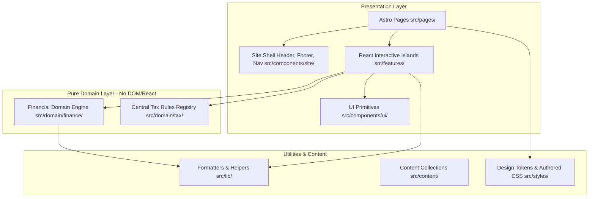

# Ant Wealth Creation — System Architecture (`new-app/`)

## 1. Architectural Philosophy

The new **Ant Wealth Creation** application is engineered around four core tenets:
1. **Static-First Performance & SEO**: Content pages, articles, and marketing shells are statically rendered at build time using Astro 5, producing lightweight zero-JS HTML by default.
2. **Islands of Interactivity**: React 19 is leveraged exclusively for interactive financial widgets, sliders, calculators, and multistep goal wizards via Astro client directives (`client:load`, `client:idle`, `client:visible`).
3. **Pure Domain Isolation**: Financial calculations and tax formulas are kept strictly isolated from the presentation layer, browser storage, and UI framework.
4. **Regulatory Transparency & Versioning**: Tax and financial assumptions are treated as versioned statutory data structures with explicit effective dates, audit trails, and legal review gates.

---

## 2. Layered Architecture Overview

---

## 3. Pure Financial Domain Engines (`src/domain/finance/`)

Implemented in **Phase 6** with 100% pure TypeScript functions, strict parameter validation (`FinanceValidationError`), and independent mathematical test vector verification.

### Active Engines
1. **`investmentRates.ts` (Effective Annual Rate Conversion)**
   - Displayed "Assumed annual return" is treated strictly as an **Effective Annual Rate (EAR)**.
   - Monthly compounding uses the mathematically equivalent geometric formula:
     $$i = (1 + r_{\text{annual}})^{1/12} - 1$$
   - Eliminates the legacy flaw of dividing the effective annual rate by 12.
2. **`sip.ts` (Wealth Accumulation Engine)**
   - Contribution Timing: **Beginning-of-Month (Annuity-Due)**.
   - Closed-form formula:
     $$\text{FV} = P \times \frac{(1+i)^n - 1}{i} \times (1+i)$$
   - Annual Step-Up: First 12 installments remain at base installment; step-up applies strictly at Month 13, Month 25, etc.
   - Zero-rate limit: $\text{FV} = P \times n$.
3. **`lumpsum.ts` (One-Time Capital Growth)**
   - Effective annual compounding for integer year horizons:
     $$\text{FV} = P \times (1 + r_{\text{annual}})^t$$
   - Zero-rate limit: $\text{FV} = P$.
4. **`targetCorpus.ts` (Reverse Annuity-Due Solver)**
   - Inverts the Annuity-Due formula using the shared geometric monthly rate.
   - Zero-rate limit: $P_{\text{required}} = C / n$.
   - Supports offset for existing earmarked invested capital.
5. **`goalPlanner.ts` (Milestone Planning)**
   - Compounding future goal cost with an independent inflation assumption:
     $$C_{\text{future}} = C_{\text{today}} \times (1 + r_{\text{inf}})^t$$
   - Existing savings grow under assumed investment return:
     $$\text{FV}_{\text{savings}} = S_{\text{existing}} \times (1 + r_{\text{inv}})^t$$
   - Solves for required monthly SIP against the net funding deficit.
6. **`netWorth.ts` (Balance Sheet Aggregation)**
   - Grounded in the **REAL Financial Statement** specification.
   - Aggregates Liquid Reserves, Financial Assets, and Physical Assets.
   - Consolidates Secured and Unsecured Liabilities.
   - Solvency Metrics: Total Net Worth, Productive Liquid Net Worth, and Debt-to-Asset Ratio.
7. **`homeLoanAmortization.ts` (Reducing-Balance Amortization)**
   - Retail loan convention: Nominal annual rate divided by 12 ($i = r_{\text{loan}}/12$).
   - Payments occur at the **end of each monthly period** after interest accrual.
   - Part-Prepayments: Evaluates both **Tenure Reduction** and **EMI Reduction** modes with full month-by-month schedules.

### Scope Gates Status
- **GATE-A (Retirement Accumulation & 3-Bucket Distribution)**: DEFERRED / SCOPE BLOCKED pending dedicated distribution specification.
- **GATE-C (Income Tax Haircuts & Slabs)**: DEFERRED / SCOPE BLOCKED pending IT Act 2025 transitional review.
- **Loan vs Invest Comparison, Loan Recovery Crossover, SWP Depletion, Life Insurance HLV, Seven-Pillar Health Score**: DEFERRED / SCOPE BLOCKED to future dedicated phases.

---

## 4. Layer Boundary Contracts

### A. Presentation Layer (`src/pages/`, `src/layouts/`, `src/components/`, `src/features/`)
- **Astro Components (`.astro`)**: Responsible for HTML document structure, OpenGraph meta tags, Schema.org JSON-LD structured data, responsive headers, navigation, footers, and static marketing copy.
- **React Components (`.tsx`)**: Responsible strictly for dynamic state (input slider updates, live charts, step transitions).
- **Styling**: Authored CSS referencing CSS custom properties defined in `src/styles/design-tokens.css`. No external heavy CSS frameworks or black-box component libraries.

### B. Pure Financial Domain Layer (`src/domain/finance/`)
- **Rules**:
  - Pure TypeScript functions and type definitions only.
  - Zero imports from `react`, `astro`, `window`, `document`, or `localStorage`.
  - Every calculation function accepts explicit input parameters and returns an immutable result object with full precision, schedule progression, and explicit assumption strings.
  - 100% test coverage with verifiable mathematical test vectors in `tests/unit/`.

### C. Versioned Tax Rules Layer (`src/domain/tax/`)
- **Rules (Enforced under GATE-C)**:
  - Fixed statutory section numbers must never be hardcoded into UI copy.
  - All tax slabs, indexation rules, deduction limits, and capital gains exemptions must reside in versioned modules keyed by **Tax Act** (`IT_ACT_1961` vs `IT_ACT_2025`) and **Assessment Year**.
  - Every rule entry maintains a `professionalReviewStatus` flag (`'PENDING_REVIEW' | 'VERIFIED'`).

### D. Utility & Formatting Layer (`src/lib/`)
- Pure helper functions for Indian currency display (`formatINR`, `formatIndianCompact`), dates, and number parsing.

---

## 5. Privacy and State Persistence Policy (GATE-D)

1. **No Inherent "Encrypted localStorage"**: Browser `localStorage` is plaintext storage vulnerable to any script running in the same origin.
2. **Ephemeral by Default**: All calculator inputs in the new application are in-memory React state during active session usage.
3. **Future Persistence Requirements**:
   - Must require explicit user consent via an opt-in toggle.
   - Sensitive financial values must never be appended into shareable URL query parameters without user confirmation.
   - Zero transmission of user financial inputs to any third-party tracking, analytics, or CRM scripts.
   - Provide a prominent, single-click "Clear Stored Data" action.

---

## 6. Testing & Quality Strategy

- **Unit Testing (Vitest)**: Tests all pure financial algorithms, tax registries, and formatting helpers. Runs in `< 1s` in Node.js environment without DOM overhead.
- **Diagnostic Type Check (`astro check`)**: Validates Astro component templates, frontmatter TypeScript types, and route parameters.
- **Linting (ESLint 9)**: Enforces code style, unused import removal, and syntax correctness.
- **End-to-End Testing (Playwright)**: Verifies real browser rendering, layout shift, interactive island mounting, console error absence, and responsive accessibility across desktop and mobile viewports.
